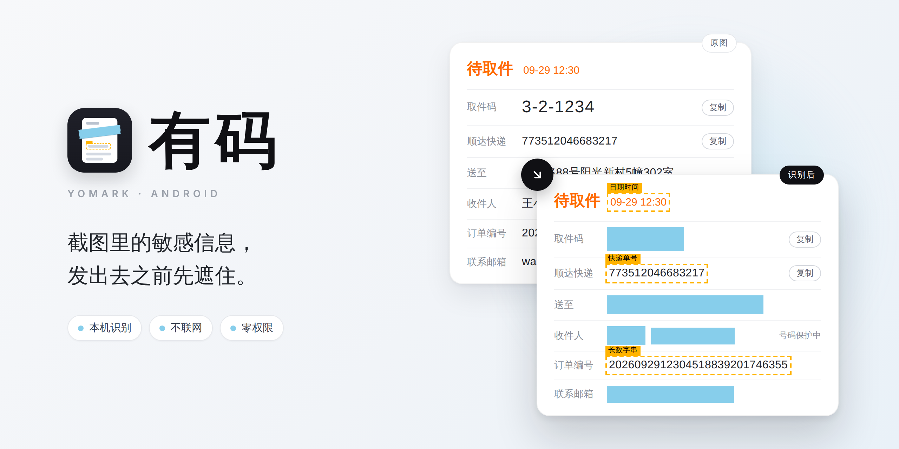

<p align="center">
  
</p>

<p align="center">
  <a href="https://github.com/FlintyLemming/yomark/releases"></a>
  <a href="https://github.com/FlintyLemming/yomark/actions/workflows/android-apk.yml"></a>
  
</p>

<p align="center">自动找出截图里的手机号、地址、人名、取件码、车牌、人脸、二维码等敏感信息并打码。<br>识别、编辑、导出全部在手机上完成，应用没有联网权限，也不申请任何运行期权限。</p>

## 功能

- **自动识别**：内置 PP-OCRv6 文字识别，配合规则引擎判断哪些内容属于敏感信息；人脸和条码由 ML Kit 的离线模型识别。
- **两级处理**：有把握的直接打码；拿不准的先不打码，图上也不标，导出前还没打码的话会先提醒。点一下码就取消，点一下没打码的字，就把那一行打上码。
- **六种样式**：色块、表情、抹除、马赛克、模糊、马克笔，每一块码各用各的样式。色块的颜色、表情和底色、马赛克的粗细、模糊的强度、马克笔的颜色和浓淡都能调，还能用吸管从图上取色。预览和导出使用同一套渲染器，所见即所得。
- **手动补框**：单指拖出一个框补上漏掉的地方，双指缩放和平移。
- **批量处理**：从相册一次分享多张图，或在应用里一次选多张。底部的胶片条上点哪张看哪张，每张第一次打开时才识别，看完一起导出。
- **替别的应用选图**：别的应用要图时可以选「有码」，比如 Telegram 附件面板拉到全屏后，右上角「⋮」里的「在外部应用中打开」。选好图、打完码点「完成」，图直接交回给它，不存进相册。
- **宽屏适配**：平板、折叠屏展开、阔折叠上，画面上框出的每一处都按位置列在画布旁边，带原图上的缩略图，点一下就打码或取消打码。竖着拿时列表在画布下面、样式方块在它左边，横着拿时这一块挪到画布右边。普通手机横着拿时，样式和导出也挪到画布右边，只是没有列表。
- **用途水印**：在整张图上平铺一行文字，例如「仅供办理签证使用」，被挪作他用时一眼就能认出来。
- **干净导出**：按原图分辨率重新绘制并编码，不保留任何 EXIF 信息。

## 使用

1. 在首页选一张图，或者在相册里把图分享给「有码」。
2. 等待识别完成，通常只需一两秒。识别时画面上有一道扫光；也可以在设置的「外观」里换成「磨砂」：整页模糊、闪着细碎的光点，中间转着等待图标，识别完从中心散开。识别完，有把握的已经盖上了天蓝色块，点一下就取消。还想遮的字，点一下它，文字识别框出的那一整行就打上码，再点一下取消；人脸、条码这类整块的东西，点一下盖住整块。
3. 有漏掉的地方，用一根手指拖出一个框。画完可以直接拖四个角调大小、拖中间挪位置，框上方的「删除」可以删掉它；之后想再改，点一下框就行。
4. 底栏的「打码」里是色块、马赛克、模糊，「编辑」里是马克笔、画笔和用途水印。点一组，它所在的胶囊撑满这一行、展开成它的工具，点最左边的返回收起。想换个样子，点一种样式；要调颜色、粗细等，再点它一下，屏幕底部会弹出它的调节面板，盖在图上，不会把图挤小；往下拖或点面板外面就收起。换色块、马赛克、模糊时，图上已经打好的这三种码一起换；在设置的「编辑」里关掉，就只换选中的框和之后新打的码。刚画完（或点选中）的框会跟着面板一起变，但马克笔、画笔不会把打码的框变成标记，反过来也一样。识别出来直接打的码、点一下打上的码、导出前的「全部打码」都用「打码」里上次选的样式，手里拿着马克笔、画笔时也是；下次打开编辑器，先拿着的也是它。
5. 点「导出」。如果还有识别到了、没打码的内容（已经被你点的那一行、拉的框盖住的不算），会先列出来让你再确认一次（可在设置的「导出」里关闭这个提醒）。

自动识别出来的码只能在打码和不打码之间切换，不能删除，避免误删后再也找不回来；点一行字打上的码，再点一下就拿掉。手动框反过来：点它不切换状态，而是选中它来调整或删除。

平板和折叠屏上，画布旁边还有一份框的列表：每一行是那一块在原图上的缩略图（打了码的也看得见底下原来是什么）和类型，点一行和在图上点那一块一样。打了码的那几行整行灰下去，还没打码的是彩色、描琥珀色边：识别到了但没打码的，图上不标，只在这里看得见。样式换成两行三列的圆角方块，铺满给它的那一块；点开的调节面板占列表的位置。

界面的主题色默认跟随系统的壁纸取色（Android 12 及以上），也可以在设置的「外观」里换成紫、蓝、青、绿、橙、红、粉中的一种。

## 识别范围

| 默认直接打码 | 默认只圈出（不打码，导出前提醒） |
|---|---|
| 电话、邮箱、人名、地址、取件码、车牌 | 快递单号、长数字串（订单号、交易号等） |
| 银行卡号（含安全码、有效期）、IBAN、证件号码、护照号与机读码、社保号、出生日期 | 日期时间 |
| 车架号、密钥（API key）、MAC 地址 | 网址、IP 地址 |
| 人脸、能解码的二维码和条形码 | 无法解码的疑似条码（条码设为「宽松」时） |
| 聊天截图里发言者的头像、昵称和聊天标题 | |

聊天截图按版面认，不分是哪个应用：先看这一页像不像聊天记录（底部输入栏、居中的时间、左右两列消息、贴边的一列头像），
像的话遮住每个发言者的头像和昵称（消息上方的、气泡里第一行的、「"张三" 撤回了一条消息」里的），以及顶栏的对方名字或群名（去掉人数）。
微信、QQ、Telegram、WhatsApp、iMessage、LINE、Messenger 的左右气泡式和 Discord、Slack 的单列式都认得出；通讯录、会话列表不算聊天页。
和底色几乎一样的灰白默认头像只剩一个剪影，按同一列其他头像的大小补框。

证件照和表单上字段名常写在值的上面：护照资料页「Surname」「Date of birth」「Passport No.」下面的姓名、出生日期、护照号，
「Place of birth」下面的出生地，订单页单独一行的「Shipping Address」下面的几行地址，都按各自的类型认。护照、身份证底部的机读码去掉 OCR 补的空格再认，
里面的证件号、生日、姓名在页上别处出现（幽灵像旁边那行小字）也会认出来。出生日期只认字段名指明了的、或者与机读码、身份证号对得上的，其余日期仍按日期时间只圈出。

中国的证件按字段认，遮值不遮字段名：
- 身份证人像面：姓名、出生、折成几行的住址、公民身份号码。照片上字段名读坏了（「姓」读丢、「性别」读成「性新」）、号码中间被补了空格，也认得出；
- 驾驶证、行驶证：中英文并排的字段名（「姓名 Name」「车辆识别代号 VIN」）英文跳过去再取值，值隔着大半栏也接得上；
- 户口簿、居住证、出生医学证明、毕业证、学生证上的姓名、住址、出生日期（只写到月的、民国和日本年号纪年的也认）；
- 往来港澳台通行证、回乡证、台胞证上的号码和机读码；
- 证件号码：大陆身份证号核对地区码、生日和校验码，没有字段名也认；香港身份证号、巴西 CPF 按校验位认，韩国的有校验位就认；台湾、新加坡、马来西亚的身份证号和日本在留卡号要页上写着是哪儿的证件；其余的只认字段名后面的。前面、左边、上面写着「订单号」「办件编号」这类字的不算。

竖着、倒着、拍歪了的照片先转正再读，人脸也转正了再找；截图里转过的证件照按它自己的方向认；斜着压在证件上的水印下面的字也读得出来。

车牌按写法认：中国大陆（含新能源、警、学、挂、港澳）、日本、英国、法国、意大利、巴西、俄罗斯、乌克兰、印度、新加坡、比利时、荷兰、爱尔兰、越南这些写法独特的直接打码，
上下两行的牌子（大车尾牌、摩托、日本的牌子）拼成一块认；德国、西班牙、「ABC-1234」这类写法不够独特的，在照片上单独成行时只圈出；
「车牌号」「License plate」「Kennzeichen」这类字段后面的，哪国写法都打码。韩国、泰国的车牌认不了：识别模型读不了谚文和泰文。

每一类都可以在设置里改成「打码」「仅圈出」或「关闭」：文字按类型逐条设，人脸、条码、聊天记录各一项，人脸和条码另外还各有自己的识别模式（快速 / 精确、严格 / 宽松）。

## 导出与水印

- 导出在原图分辨率上重新绘制、重新编码。EXIF 里的位置、机型、拍摄时间一律不保留。
- 用途水印的颜色、角度、透明度和密度都可以调，带实时预览。
- 开源版全功能免费。导出默认在右下角带一个「有码 Yomark」小水印（自动避开打码区域）；点首页或编辑器右上角的按钮，在弹窗里点「去除水印」就能免费去掉，之后在 设置 → 导出 里可以改回来。弹窗里另有打赏入口：点「打赏」会用系统浏览器打开 <https://pay.mitsea.com>，应用自己不发任何网络请求。
- 上架 Play 商店的是内购版：免费导出时同样带这个小水印，一次性买断可以去掉，之后在 设置 → 导出 里可以改回来。那也是唯一的付费项，其他功能不受限制。内购版没有打赏入口：Play 的付款政策不允许在应用里把用户引到 Play 结算以外的付款方式。

## 隐私与权限

完整的[隐私权政策](https://yomark.flinty.moe/privacy/)（源文件 [site/privacy/index.html](site/privacy/index.html)，和落地页一起由 GitHub Pages 发布）也能在应用的「设置 → 关于」里打开。

- 不申请任何运行期权限。选图通过系统的 Photo Picker 完成，应用只能拿到你选中的那几张图，读不到相册里的其他图片。
- 没有网络权限。ML Kit 的依赖会把 `INTERNET` 和 `ACCESS_NETWORK_STATE` 带进 manifest，构建时会把这两条移除，系统层面就不会给这个进程开网络。
- 构建任务 `assertDebugNoRuntimePermissions` 会检查合并后的 manifest。除了下面三条不涉及数据访问的声明，多出任何一条权限都会让构建失败：
    - `com.android.vending.BILLING`：Play 内购，购买在 Play 商店的进程里进行。开源版不连 Play Billing，留给以后上架的版本。
    - `com.google.android.apps.aicore.service.BIND_SERVICE`：「AI 增强识别」绑定系统的 AICore，模型在本机运行。
    - `moe.flinty.yomark.DYNAMIC_RECEIVER_NOT_EXPORTED_PERMISSION`：androidx 自动生成的 signature 级权限，其他应用无法获取。

## 实现

- **文字识别**：默认使用 PP-OCRv6 small（ONNX Runtime，模型随安装包分发）。它对中文截图里带星号的号码、生僻字人名识别效果好，并能给出单字级别的框。设置里可以切换到 ML Kit 的拉丁或中文模型，也可以让两者同时运行。
- **敏感信息判断**：由规则决定，不交给模型。规则由正则和校验位组成（银行卡 Luhn、IBAN mod 97、UPS 单号等），电话用 libphonenumber 解析，人名用 HanLP 的离线词典。每条命中都可以解释原因，也都有单元测试。
- **人脸与条码**：ML Kit 的 bundled 版本，模型同样随包分发。
- **聊天截图**：不用模型，按 OCR 行的排法和像素找（`chat/ChatLayout.kt`）。规则在合成的聊天页上调过（`tools/model-eval/make_chat_samples.py`），调研和实测见 [docs/chat-layout-research.md](docs/chat-layout-research.md)。
- **AI 增强识别**：在支持 AICore 的机型上，编辑器里会多出这个按钮。点击后由本机的 Gemini Nano 把整页文字再读一遍，新发现的内容只圈出，不会自动打码。本机有没有 Gemini Nano、是哪一版（nano-v2、nano-v3 等），可以在设置的「AI」里看到。

## 下载

在 [Releases](https://github.com/FlintyLemming/yomark/releases) 下载 APK：真机装 `arm64-v8a`，模拟器装 `x86_64`。安装包是 debug 构建、固定签名，可以直接覆盖升级。

在 Actions 页面手动触发 Android APK 工作流会打一份 APK，可以在对应运行的 Artifacts 里下载。触发时填写版本号，单元测试通过后会自动发布 Release，说明取自 `docs/release-notes/<版本号>.md`。

## 构建

需要 JDK 21 和 Android SDK 36。最低支持 Android 10（minSdk 29）：从这一版开始，应用读写自己创建的图片不需要存储权限，这是零权限的前提。

```sh
./gradlew :app:assembleDebug              # APK 按 ABI 拆分：真机装 arm64-v8a，模拟器装 x86_64
./gradlew :app:testDebugUnitTest          # Robolectric；PP-OCR 用桌面版 ONNX Runtime 跑真模型
./gradlew :app:connectedDebugAndroidTest  # 需要连接设备或模拟器
```

## 项目结构

```
app/src/main/java/moe/flinty/yomark/
  core/      几何、图片读取、打码方案（MaskPlan）的数据模型
  engine/    OCR、人脸、条码的封装，候选去重合并
  rules/     敏感信息规则与校验位
  render/    六种样式的渲染器，预览和导出共用
  export/    原图重绘、品牌水印、用途水印、写入相册（或交给来要图的应用）
  ui/        首页、编辑器、设置（Jetpack Compose）
  billing/   发行版本开关（开源版免费）、去水印的一次性购买
docs/        设计文档、模型调研、上架验收记录、Play 商品详情的文字与图片（docs/play/）
tools/       模型评测、测试语料、主题配色表和落地页小图的生成脚本
site/        落地页和隐私权政策页，纯静态，由 .github/workflows/pages.yml 部署到 GitHub Pages
```

设计上的取舍见[总体方案](docs/superpowers/specs/2026-09-02-yomark-android-design.md)，各项指标的实测数值见[上架验收记录](docs/release-checklist.md)。

---

<sub>头图用样图的内容排版合成，其中的人名、地址、号码都是虚构的；样式对照图裁自 `ReadmeScreenshots` 在 Robolectric 上用真实识别流程拍下的编辑器截图。重新生成的方法见 [docs/readme/src/render.cjs](docs/readme/src/render.cjs)。</sub>
