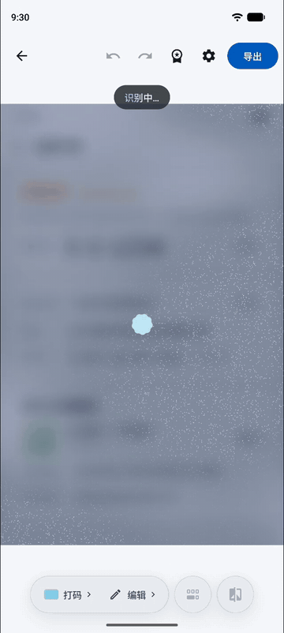
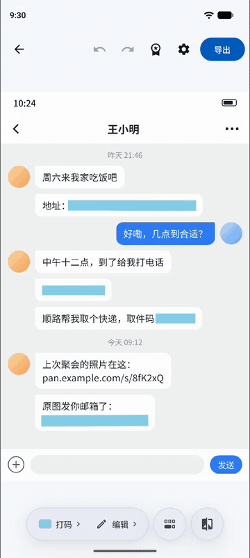
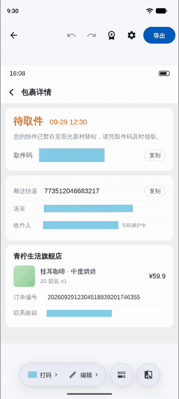
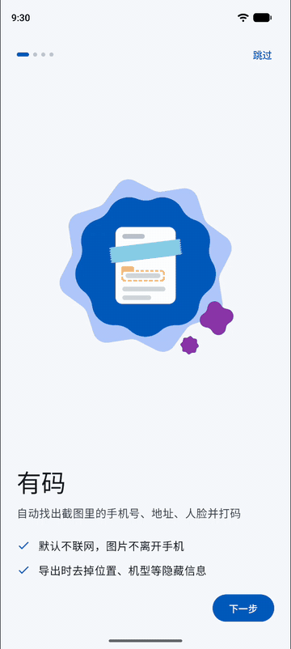
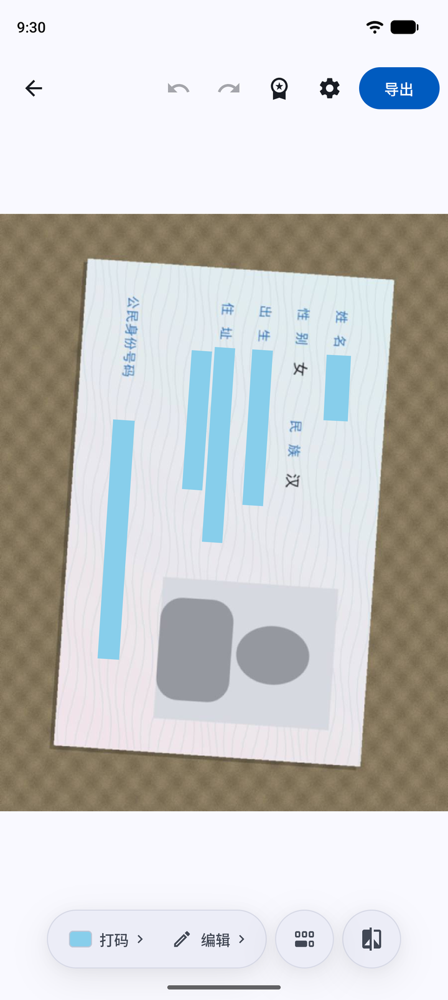
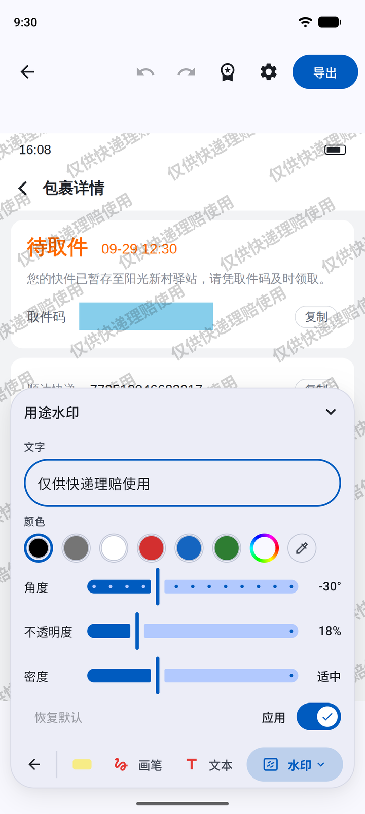
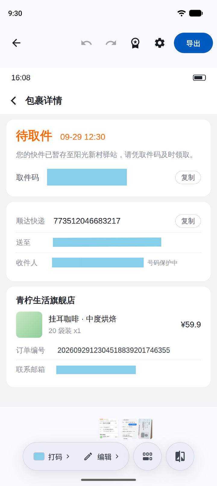
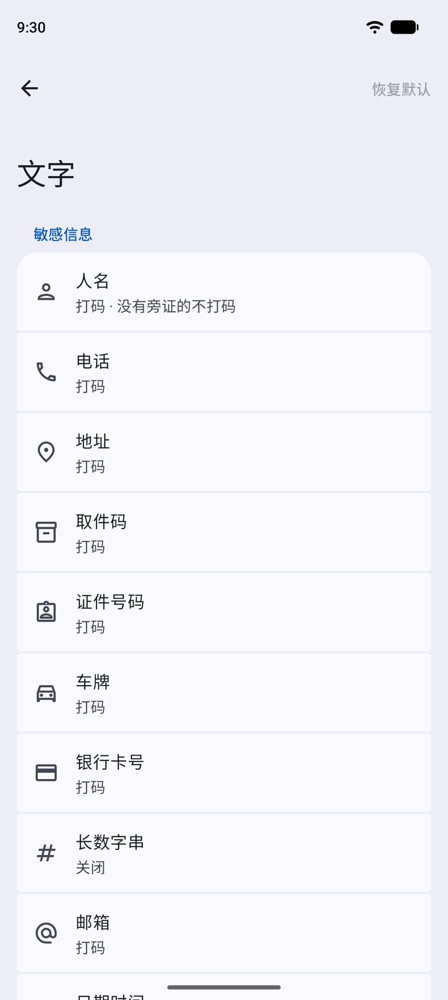
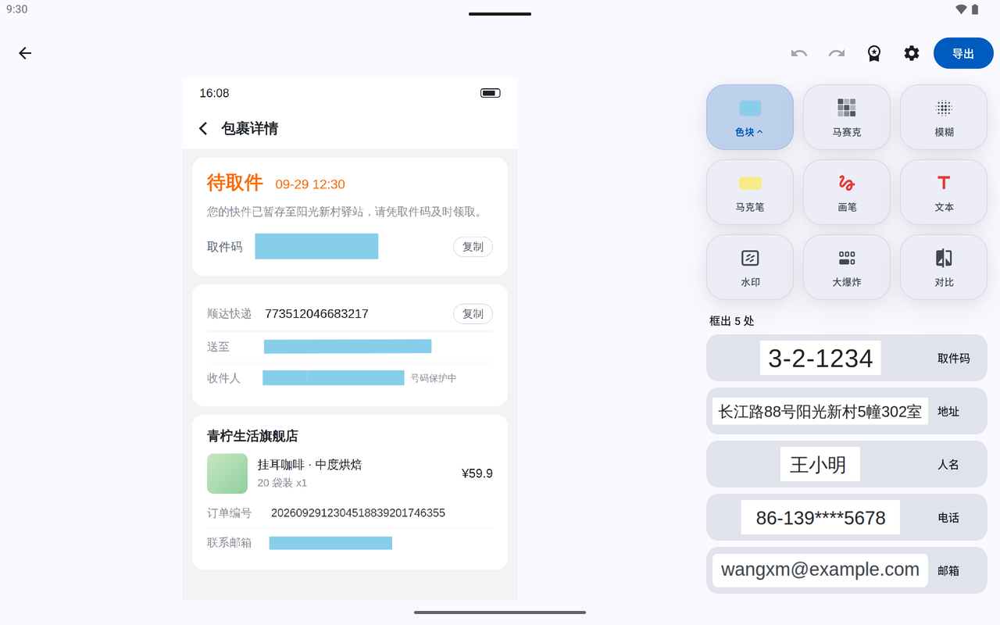

<p align="center">
  
</p>

<p align="center">
  <a href="https://github.com/FlintyLemming/yomark/releases"></a>
  <a href="https://github.com/FlintyLemming/yomark/actions/workflows/android-apk.yml"></a>
  
</p>

<p align="center">自动找出截图里的手机号、地址、人名、人脸、二维码并打码<br>本机识别，默认不联网，不申请任何运行期权限</p>

<table>
  <tr>
    <th>自动打码</th>
    <th>点一下增减</th>
    <th>大爆炸</th>
  </tr>
  <tr>
    <td></td>
    <td></td>
    <td></td>
  </tr>
  <tr>
    <th>换样式</th>
    <th>拖框补漏</th>
    <th>首次引导</th>
  </tr>
  <tr>
    <td></td>
    <td></td>
    <td></td>
  </tr>
</table>

<table>
  <tr>
    <th>证件照</th>
    <th>用途水印</th>
    <th>批量处理</th>
    <th>识别规则</th>
  </tr>
  <tr>
    <td></td>
    <td></td>
    <td></td>
    <td></td>
  </tr>
</table>

<table>
  <tr>
    <th>平板、折叠屏</th>
  </tr>
  <tr>
    <td></td>
  </tr>
</table>

**[完整功能说明 →](docs/features.md)**

## 下载

[Releases](https://github.com/FlintyLemming/yomark/releases) 里下载 APK：真机装 `arm64-v8a`，模拟器装 `x86_64`。

## 反馈

欢迎反馈：

- **识别问题**：哪种截图漏遮、遮错、该认的没认出来，发邮件到 [yomark@flinty.moe](mailto:yomark@flinty.moe)。附上截图更好查，邮件不公开。
- **使用体验**：闪退、不好用、想要什么功能，提 [GitHub Issues](https://github.com/FlintyLemming/yomark/issues/new/choose)。Issues 所有人都看得到，附截图前先用有码打码。

应用里「设置 → 关于 → 反馈」会带上版本和机型。

## 构建

```sh
./gradlew :app:assembleDebug        # JDK 21、Android SDK 36
./gradlew :app:testDebugUnitTest
```

<sub>截图和动图由 [docs/readme/src/capture.ps1](docs/readme/src/capture.ps1) 在模拟器上拍真实应用，样图里的人名、地址、号码都是编的</sub>
